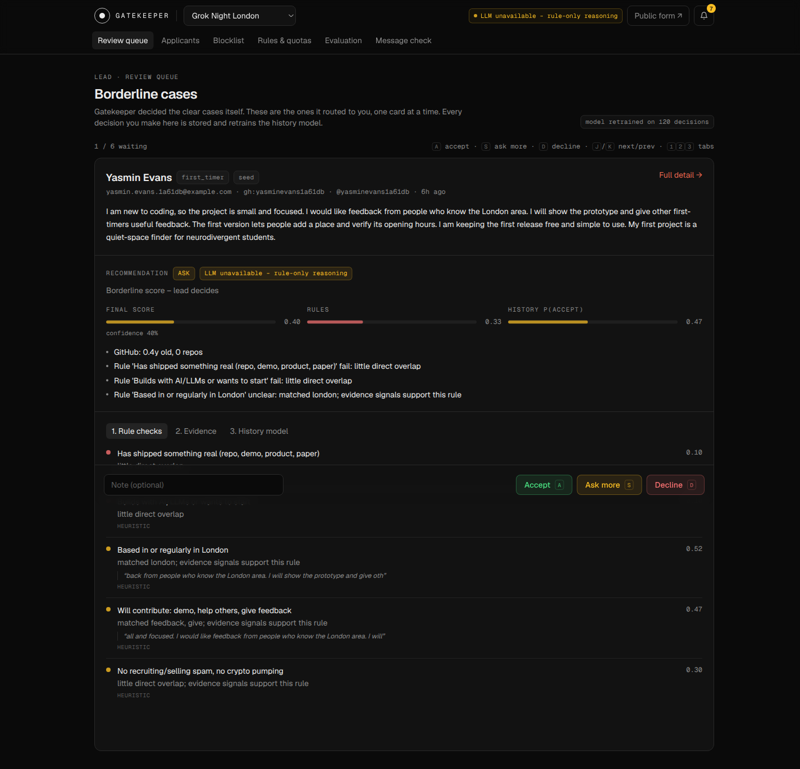
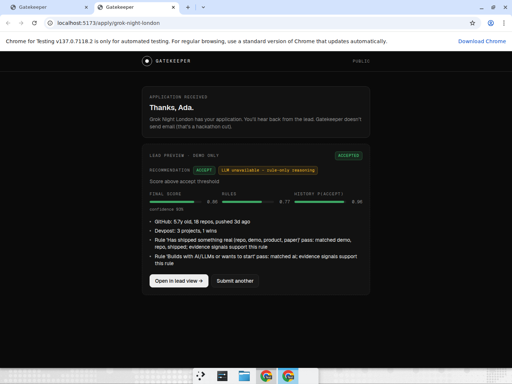
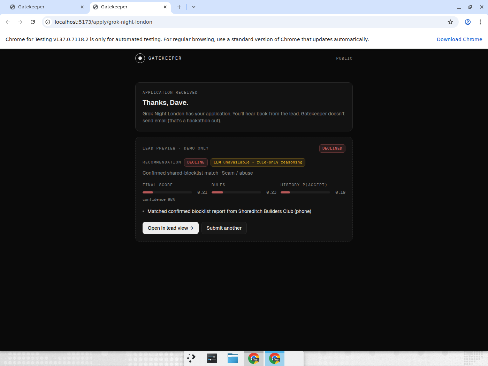
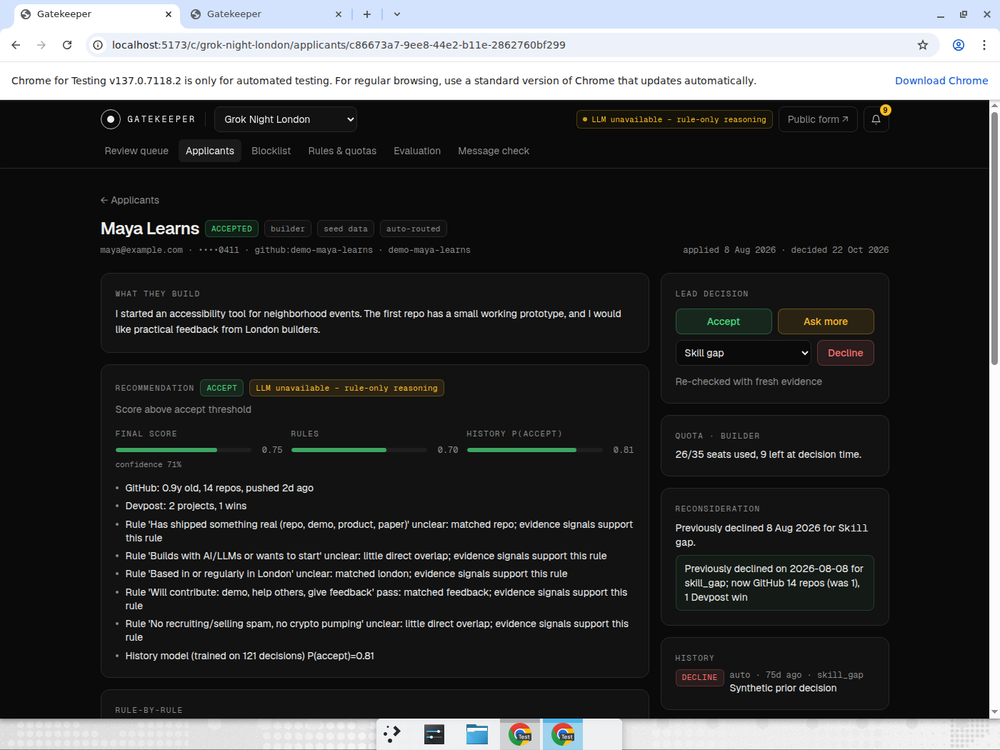
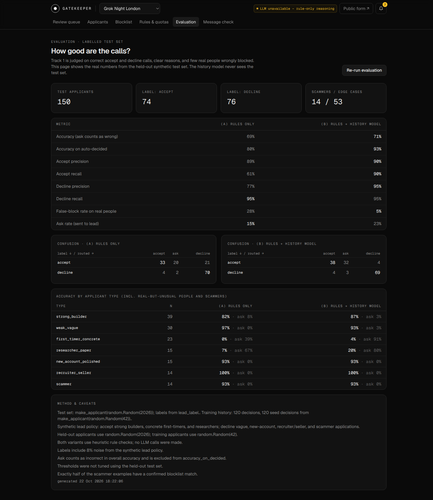

# Gatekeeper

**Application vetting for community leads.** London Grok Bot "Community Engineering" hackathon, Track 1 · Vetting & moderation. MIT licensed.

The lead writes the community's rules in plain English and sets seat quotas per guest category. Gatekeeper then:

1. Scores every applicant against those rules (Gemini by default, optional Grok structured output, or deterministic heuristics when the selected provider is unavailable) and against public evidence: GitHub, Devpost, StopForumSpam and a shared cross-community blocklist.
2. Adjusts the call with a small **history model** (logistic regression) trained on that lead's own past accept/decline decisions.
3. Routes each applicant to **accept**, **ask** (the lead's review queue, plus a notification) or **decline**, always with a list of reasons and a confidence.
4. Enforces **per-category quotas**. When a category is full, accepted applicants go to a ranked waitlist; VIPs can bypass the quota.
5. **Reconsiders** old declines for a skill gap, a minor issue or capacity after a cool-down. Scam/abuse declines are never reconsidered.
6. Shares a **blocklist** between communities: a scammer confirmed by community A is stopped at community B, with evidence. Only hashes are shared, and Postgres RLS keeps pending reports private.

| Review queue (borderline cases, one card at a time) | Strong builder auto-accepted with reasons |
|---|---|
|  |  |
| **Known scammer stopped by community A's confirmed report** | **Old skill-gap decline reconsidered** |
|  |  |
| **Evaluation: rules only vs rules + history** | |
|  | |


## Architecture

```
frontend/ (React + Vite + TS + Tailwind, Geist)         backend/ (FastAPI + Pydantic v2 + psycopg)            Postgres (Supabase-compatible SQL)
  Apply form ──POST /api/communities/{slug}/apply──▶  services/evidence.py  GitHub · Devpost · SFS (parallel, timeouts)
  Review queue / Applicants / Detail                 services/rules.py     Gemini/Grok JSON → Pydantic RuleCheck | heuristic_checks
  Blocklist / Appeals / Settings / Eval              services/history.py   LogisticRegression on lead decisions
                                                     services/router.py    ordered routing + quota/waitlist     ──▶ applicants, decisions,
                                                     services/actions.py   lead decisions, re-check, retrain        categories, blocklist_entries (RLS),
                                                     APScheduler           daily reconsideration job                appeals, notifications, model_runs
```

The REST contract (every route and JSON shape) is in [`docs/API.md`](docs/API.md), kept stable so this project can be combined with the user's other one.

### Why each component exists

| Component | Why |
|---|---|
| Written rules, scored rule by rule | Leads already have unwritten criteria. Writing them down makes every verdict explainable ("Rule 3 failed: …"). |
| Gemini by default; Grok optional (`services/rules.py`) | Reading free text against free-text rules is the one step that needs a language model. The provider is selected with `LLM_PROVIDER`; output is validated with Pydantic, quotes must appear verbatim in the application, and invalid replies fall back to heuristics and are labelled as such. |
| Deterministic router (`services/router.py`) | Safety rules (blocklist, spam signals, incomplete forms) and thresholds stay in code, where they are testable, rather than in a prompt. |
| History model (`services/history.py`) | Every community is different. The model learns what *this* lead actually accepts (e.g. first-timers with a small real project) and shows its top feature contributions. If it disagrees with the rules, the applicant goes to the lead instead of being guessed. |
| Review queue with shortcuts | Borderline cases go to a human. A/S/D plus number keys for decline reasons clear a week of applications in minutes, and every click becomes training data. |
| Quotas + waitlist | An event has a fixed number of seats per kind of guest. Accepted applicants beyond the quota are waitlisted and ranked by score. |
| Reconsideration | A skill gap is temporary. Re-checking evidence after the cool-down lets people who have since shipped get in. |
| Shared blocklist with HMAC + RLS | Communities can catch the same scammer without exchanging raw phone numbers, and unconfirmed accusations never leave the reporting community. |

## Run it

Prerequisites: Python 3.11+, Node 20+, Docker (for local Postgres).

```bash
# 1. Database (local Postgres 16 by default; Supabase uses the gatekeeper schema)
docker run -d --name gk-pg -e POSTGRES_PASSWORD=postgres -e POSTGRES_DB=gatekeeper -p 5432:5432 postgres:16

# 2. Backend → http://localhost:8000 (migrates, seeds if empty, starts uvicorn)
cd backend
python3.11 -m venv .venv && .venv/bin/pip install -r requirements.txt
cp .env.example .env            # optional: add GEMINI_API_KEY, or select Grok with LLM_PROVIDER=grok and XAI_API_KEY
source .venv/bin/activate && ./run.sh
# To use backend/.env.supabase instead: ENV_FILE=.env.supabase ./run.sh

# 3. Frontend → http://localhost:5173 (proxies /api to :8000)
cd frontend && npm install && npm run dev
```

Re-seed the demo data with `python -m app.seed`. Run the evaluation with `python -m app.eval`.

### Tests and checks

```bash
cd backend && createdb -h localhost -U postgres gatekeeper_test   # once; or: docker exec gk-pg createdb -U postgres gatekeeper_test
DISABLE_SCHEDULER=1 .venv/bin/python -m pytest -q   # router, quotas, reconsideration, blocklist hashing, RLS with two community roles, API
cd frontend && npm run build && npm run lint
```

### Environment variables

| Name | Required | Purpose |
|---|---|---|
| `DATABASE_URL` | no | Postgres connection string; defaults to local Postgres, or load a Supabase pooled URL with `ENV_FILE=.env.supabase ./run.sh` |
| `DB_SCHEMA` | no | Schema used by the backend; defaults to the isolated `gatekeeper` schema |
| `SUPABASE_URL` | no | Supabase project URL (used by Supabase integrations) |
| `SUPABASE_ANON_KEY` | no | Supabase anonymous key |
| `SUPABASE_SERVICE_ROLE_KEY` | no | Supabase service-role key; keep private |
| `LLM_PROVIDER` | no | Provider for rule scoring; defaults to `gemini`, or set to `grok` |
| `GEMINI_API_KEY` | no | Gemini API key when `LLM_PROVIDER=gemini` |
| `GEMINI_MODEL` | no | Gemini model id; defaults to `gemini-3.8-flash` |
| `XAI_API_KEY` | no | xAI API key when `LLM_PROVIDER=grok` |
| `GROK_MODEL` | no | Grok model id; otherwise picked from `/v1/models` |
| `GITHUB_TOKEN` | no | Raises the GitHub REST rate limit |
| `BLOCKLIST_PEPPER` | yes in production | HMAC pepper shared by communities that pool their blocklist |
| `CORS_ORIGINS`, `DISABLE_SCHEDULER` | no | CORS origins; set `DISABLE_SCHEDULER=1` in tests |

## Live vs seeded vs simulated

| Part | Status |
|---|---|
| GitHub REST, Devpost search, StopForumSpam | **Live** for real handles and emails (each evidence card shows `live`, or `unavailable` with the error) |
| Handles starting with `demo-` | **Simulated** evidence fixtures (`backend/app/seed.py`, labelled `simulated` in the UI), so the demo is deterministic |
| Gemini rule scoring (default), Grok optional | Live when the selected provider is configured, otherwise heuristic and labelled |
| Communities, past applicants, lead decisions, blocklist reports | **Seeded** synthetic data (`is_seed=true`, `@example.com`), with no real people |
| Evaluation set | Synthetic, held out from training (see below) |
| Message check | TF-IDF + logistic regression trained on 1,000 cached rows of UCI SMS Spam |

## Evaluation

`python -m app.eval` (or **Re-run evaluation** on the Evaluation page) compares **(a) rules only** with **(b) rules + history model** on a held-out synthetic set. Latest run, committed as `backend/data/eval_report.json`:

| Metric (150 held-out applicants: 74 accept, 76 decline) | Rules only | Rules + history |
|---|---:|---:|
| Accuracy (ask counts as wrong) | 68.7% | 71.3% |
| Accuracy on auto-decided cases | 80.5% | 93.0% |
| Accept precision / recall | 89.2% / 61.1% | 90.5% / 90.5% |
| Decline precision / recall | 76.9% / 94.6% | 94.5% / 94.5% |
| **False-block rate on real people** | 28.4% | **5.4%** |
| Ask rate (sent to the lead) | 14.7% | 23.3% |

How the numbers are produced (`backend/app/synthetic.py`, `backend/app/eval.py`):
- `make_applicant(rng, kind)` generates varied applicants of seven kinds: strong builders, vague "networking" applications, first-timers with a small concrete project, researchers with a paper/Devpost project but few repos, polished text on a brand-new GitHub account, recruiters/sellers, and scammers whose text comes from real UCI SMS Spam rows. Half of the scammers have a confirmed blocklist match.
- Labels come from `lead_label`, a **synthetic lead policy** that deliberately differs from the written rules: this lead also accepts concrete first-timers and researchers, and declines polished text on brand-new accounts. 8% of labels are flipped at random as noise.
- The history model is trained on 120 seed decisions (`random.Random(42)`) and tested on 150 different applicants (`random.Random(2026)`); the eval asserts there is no overlap. Routing thresholds were fixed beforehand and not tuned on the test set. No LLM calls are made, so both variants use the heuristic rule checks.

Takeaways:
- Most of the gain is fewer real people wrongly declined: the history model learns that this lead values first-timers and researchers more than the written rules do.
- Most of those borderline people now go to **ask** rather than being decided: accuracy on concrete first-timers is 0% → 4%, with the ask rate 39% → 91%. The model moves them out of the decline bucket, but not confidently into accept, so the lead decides.
- These are synthetic numbers. They show the pipeline learning a lead's preferences from their decisions, not accuracy on real applicants.


## Demo script (2 minutes)

Setup: run `python -m app.seed`, then open http://localhost:5173 (lead view for **Grok Night London**).

1. **Review queue** (`/c/grok-night-london/queue`): "Gatekeeper decided the clear cases itself; these 6 are borderline." Open the *Rule checks* / *Evidence* / *History model* tabs with `1`/`2`/`3`. Press `A` to accept. The badge changes to "model retrained on 121 decisions".
2. **Public form** (Public form ↗): apply as `Ada`, GitHub `demo-ada-ships`, Devpost `demo-ada-ships`, category *Shipped builders*, with a concrete description. Result: **accepted**, with reasons (GitHub age/repos, Devpost wins, rule-by-rule) and one fewer seat in the quota bar.
3. Apply as `Sam`, GitHub `demo-sam-research`, category *Researchers*. Result: **ask**. A notification appears in the bell and Sam is added to the queue.
4. **The scammer**: apply as `Dave`, phone `07700 900123`, GitHub `demo-crypto-dave`. Result: **declined** with the evidence "Matched confirmed blocklist report from Shoreditch Builders Club". Community B never saw his raw number, only the hash match.
5. **Reconsideration**: Applicants → *Maya Learns* (declined 75 days ago, `skill_gap`) → **Re-check now**. Her evidence has improved (14 repos, a Devpost win), so she moves to accept or the queue, with the note "Previously declined on … for skill gap; now …". *Old Scam Example* has no re-check button, because scam/abuse is never reconsidered.
6. **Blocklist**: switch community to Shoreditch: its pending report is visible there, but not from Grok Night (RLS). Confirm or remove a report; appeals arrive through `/appeal`.
7. **Evaluation**: rules only vs rules + history; false-block rate on real people drops from 28% to 5%.


## Decisions

- **Categories**: Shipped builders (35 seats), Researchers (12), First-timers (15, smaller weight on evidence), Mentors & speakers (8), VIP / partners (10, can bypass the quota). All are editable in Rules & quotas.
- **Routing thresholds**: final score ≥ 0.62 accept, ≤ 0.38 decline, otherwise ask. The final score is the rule score alone until the community has ≥ 10 lead decisions covering both outcomes, then a 50/50 blend with P(accept). These were fixed before evaluation and not tuned on the test set.
- **StopForumSpam never auto-declines.** A hit sends the applicant to the queue, because the database has false positives and a wrongly blocked real person is the worst outcome.
- **Auth** is a community selector ("lead login") with no passwords, per the brief's cuts. Leads act as their community, and RLS is enforced through `SET ROLE gatekeeper_community` plus `app.community_id`.
- **No sentence-transformers/torch**: too heavy for the time box. Rule heuristics use token overlap; the selected LLM provider does the semantic work when available.
- **Plain SQL with psycopg** instead of an ORM, so the same migrations run unchanged on Supabase.

## Known limitations

- Without `GEMINI_API_KEY` (or `XAI_API_KEY` when `LLM_PROVIDER=grok`), rule checks are keyword heuristics and miss nuance; the badge says so.
- The history model is trained on synthetic seed decisions until a real lead has made decisions.
- Devpost has no public API, so the search page is scraped and may break or rate-limit (shown as `unavailable`).
- No real authentication, no email sending, no WhatsApp integration (cut per the brief).
- The evaluation set is synthetic. The numbers show the pipeline working as designed, not accuracy on real applicants.

## Open-source components

FastAPI (MIT), Pydantic (MIT), psycopg (LGPL-3.0), scikit-learn (BSD-3), NumPy (BSD-3), APScheduler (MIT), phonenumbers (Apache-2.0), httpx (BSD-3), openai-python (Apache-2.0; OpenAI-compatible client for Gemini and Grok APIs), React (MIT), Vite (MIT), Tailwind CSS (MIT), React Router (MIT), Geist fonts (SIL OFL 1.1), UCI SMS Spam Collection (CC BY 4.0, via the Hugging Face `ucirvine/sms_spam` rows API).

Gemini and xAI Grok are hosted model APIs, not additional open-source dependencies.
